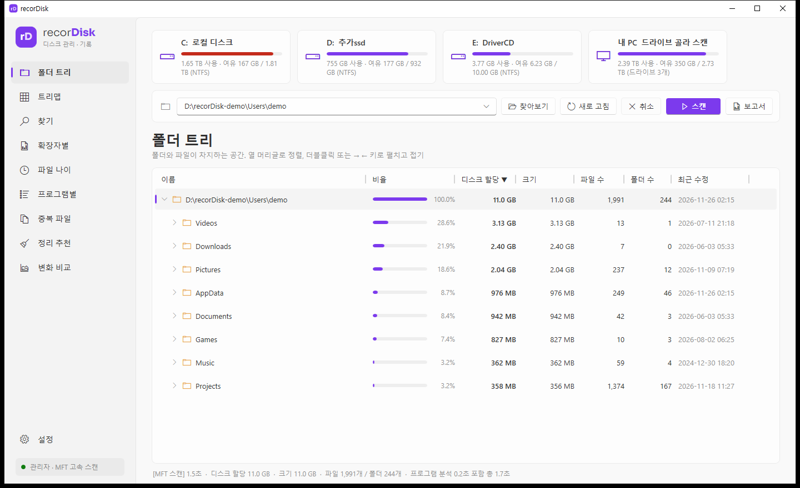
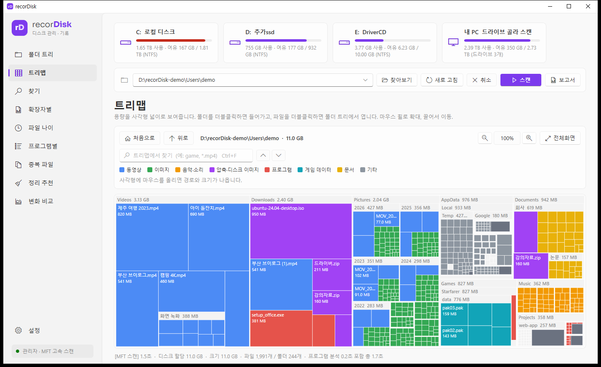
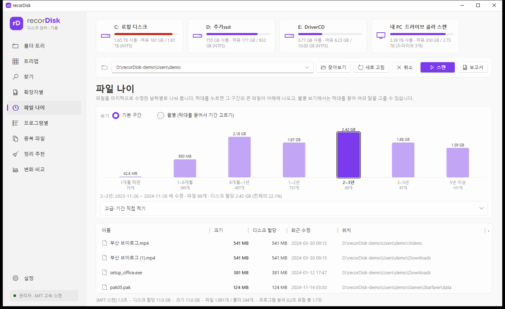
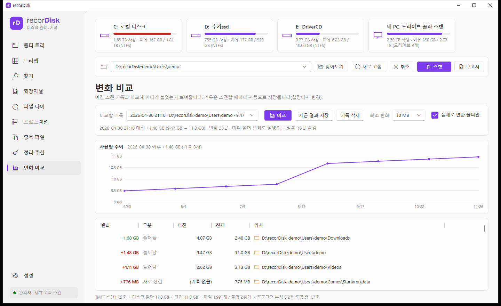
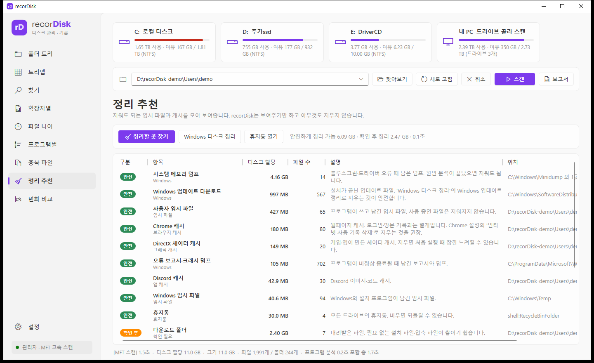
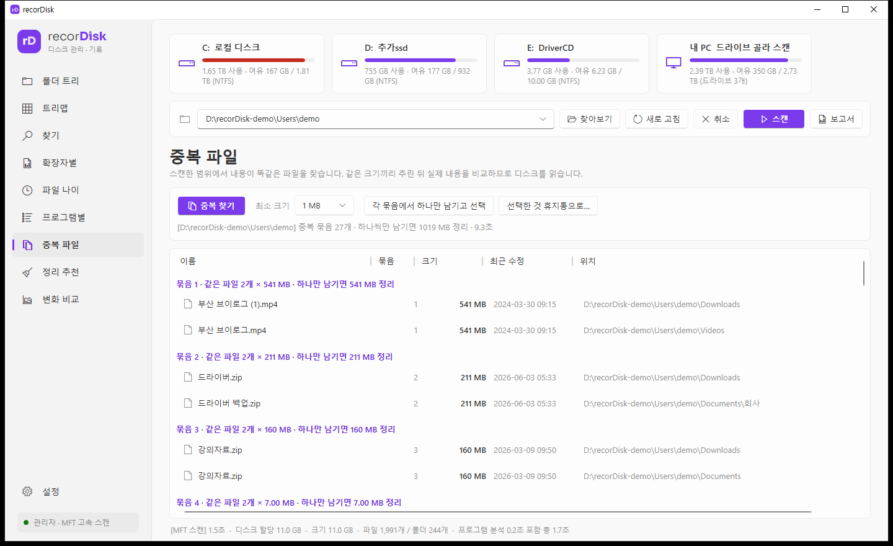

# recorDisk

Windows용 디스크 **관리·기록** 도구. NTFS MFT를 직접 읽어 드라이브 전체를 빠르게 스캔하고
무엇이 공간을 차지하는지(폴더·파일·프로그램·파일 나이)와 **언제 얼마나 늘었는지**를 기록해 보여 줍니다.

버전 1.0.2 · Windows 10/11 x64 · 한국어

<picture>
  <source media="(prefers-color-scheme: dark)" srcset="screenshots/tree-dark.png">
  
</picture>

화면은 모두 예시 폴더를 스캔한 모습입니다.

## 설치와 실행

1. [Releases](https://github.com/tachens/recorDisk-release/releases/latest)에서 `recorDisk-1.0.2-win-x64.zip`을 내려받습니다.
2. zip을 **`C:\Program Files\recorDisk`** 폴더에 통째로 풉니다(폴더를 만들 때 관리자 확인 창이 뜹니다).
   `recorDisk.exe` 옆의 DLL 파일들도 필요하니 exe만 따로 옮기지 마세요.
3. 그 폴더의 `recorDisk.exe`를 실행합니다. 자주 쓰면 마우스 오른쪽 단추 → '시작 화면에 고정'.
   .NET 이 설치되어 있지 않아도 됩니다(런타임 포함).
4. 처음 실행하면 Windows SmartScreen이 "알 수 없는 게시자" 경고를 띄울 수 있습니다(코드 서명 없음).
   "추가 정보 → 실행"을 누르면 됩니다.

> **다운로드 폴더·바탕 화면 등에서는 실행되지 않습니다.** recorDisk는 관리자 권한으로 실행되는데,
> 아무 프로그램이나 고칠 수 있는 폴더에 있으면 다른 프로그램이 파일을 바꿔치기해 관리자 권한을 얻을 수 있기 때문입니다.
> 이런 위치에서 실행하면 안내 창이 뜨고 끝납니다. Program Files처럼 관리자만 고칠 수 있는 폴더에 두세요.

- 고속(MFT) 스캔과 새로 고침은 관리자 권한이 필요해서 기본 설정에서는 시작할 때 UAC 창이 뜹니다.
  설정 → '관리자 권한으로 실행'을 끄면 일반 권한(일반 스캔)으로 실행합니다.
- 설정·스캔 기록·오류 기록은 `%LOCALAPPDATA%\recorDisk`에 저장됩니다.

## 기능

**스캔**
- 드라이브·폴더 스캔(자동·MFT 전용·일반 방식), 내 PC(여러 드라이브 한 번에)
- 새로 고침(F5): NTFS 변경 기록(USN)으로 바뀐 것만 반영해 몇 초 만에 최신화. 전체 스캔은 Ctrl+F5
- 탐색기 우클릭 메뉴 'recorDisk로 분석'(설정에서 켜기, 현재 사용자만)

**보기**
- 폴더 트리(비율 막대, 디스크 할당, 크기, 파일·폴더 수, 최근 수정), 열 머리글 정렬
- 트리맵(파일 종류별 색, 폴더 들어가기, 트리맵 안에서 찾기)
- 찾기(이름·와일드카드, 최소 크기, 수정 안 한 기간), 확장자별 통계
- 파일 나이: 수정한 날짜별 용량 막대, 월별 보기에서 막대를 끌어 여러 달 고르기
- 프로그램별 용량: 설치 목록 + Steam·Epic 게임, 설치 폴더와 AppData·ProgramData 데이터 합산

<picture>
  <source media="(prefers-color-scheme: dark)" srcset="screenshots/treemap-dark.png">
  
</picture>

**기록**
- 변화 비교: 스캔마다 기록을 자동 저장하고 예전 기록 대비 늘어난·줄어든 폴더 표시
- 사용량 추이 그래프(드라이브별, 고른 폴더)
- HTML 보고서: 파일 하나, 인터넷 없이 열림, 밝은/어두운 화면

**정리**
- 정리 추천: 임시 파일·캐시·업데이트 파일·덤프 등을 안전/확인 후/참고로 분류(직접 지우지 않음)
- 중복 파일 찾기(같은 크기 → 앞뒤 64KB → 전체 SHA-256)
- 휴지통으로 보내기(트리·찾기·중복·파일 나이 목록, 시스템 위치 보호), 프로그램 '제거…'
- CSV 내보내기(각 목록 우클릭)

**알림·설정**
- 디스크 부족 알림: 켜면 창을 닫아도 트레이에 남아 10분마다 남은 공간 확인, 기준을 넘으면 하루 한 번 Windows 알림
- 스캔 뒤 메모리 정리(선택, 기본 끔): C: 기준 약 1.1 GB → 0.7 GB, 대신 스캔 직후 1초쯤 멈출 수 있음
- 테마(시스템/밝은/어두운), 크기 단위, 보라색 테마

## 알려진 제한

- 하드링크는 첫 번째 이름에만 집계
- `$ATTRIBUTE_LIST`가 필요할 만큼 MFT가 조각난 볼륨, 클러스터 < 1KB 볼륨은 일반 스캔으로 대체
- NTFS가 아닌 드라이브(ReFS, exFAT 등)는 일반 스캔만 가능(새로 고침 없음)
- Windows 11의 새 우클릭 메뉴에는 'recorDisk로 분석'이 '추가 옵션 표시' 안에 나옴

## 라이선스

© 2026 recorDisk. 모든 권리 보유(별도 라이선스 없음).

로고 글꼴 [Sora](https://github.com/sora-xor/sora-font)는 SIL Open Font License 1.1을 따릅니다
(배포본 `licenses/Sora-OFL.txt`).
